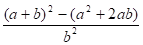

# Лабораторные работы

## Информация о студенте

**ФИО:** Казакова Елизавета Александровна 

**Группа:** РИС-26-1б
## Рассказ о себе:
Имею опыт программирования на Python и на ЕГЭ по информатике набрала 90 баллов.
Мне интересно углубляться в новые и сложные темы, разбираться в том, как всё устроено, и постоянно развивать свои навыки. Мои сильные стороны- любознательность, быстрое обучение и внимательность.

## Лабораторные работы

| № | Название | Срок | Статус |
|---|---|---|---|
| 1 | lab1 | 11.10.2026 | готово |

## картинка кота-программиста

## lab1 

**Вариант 12**

### 1. Постановка задачи 

#### Задание 1. 

Вычислить значение выражения при различных вещественных типах данных (`float` и `double`): 

при \(а=1000\), \(b=0.0001\).

Вычисления выполнять с использованием промежуточных переменных. Сравнить и объяснить полученные результаты.
#### Задание 2.
Вычислить значения выражений и объяснить полученные результаты:
1. `--m-++n`
2. `m*n<n++`
3. `n-- > m++`

### Программа решения задания 1

